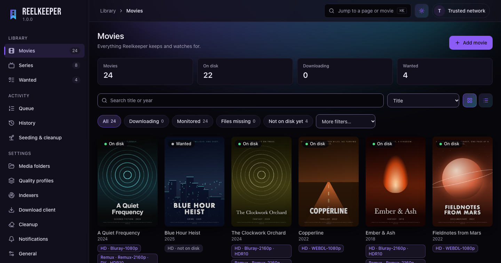
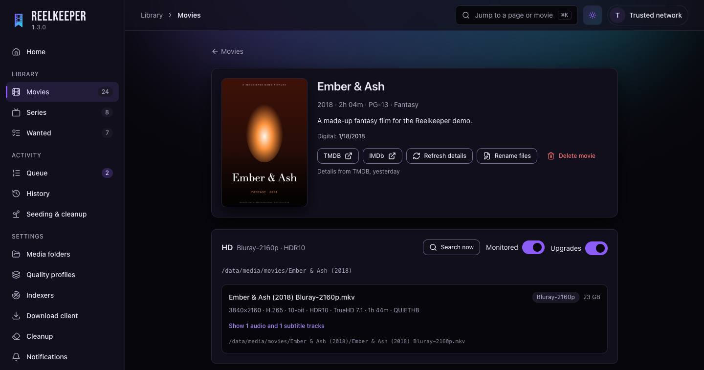
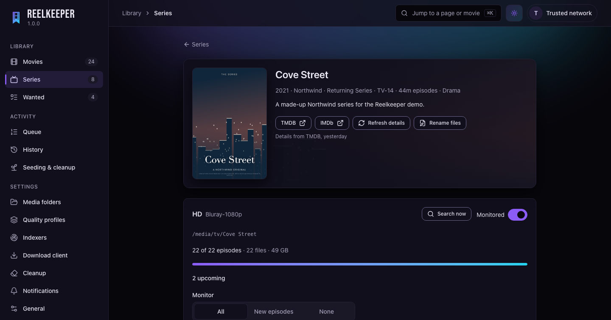
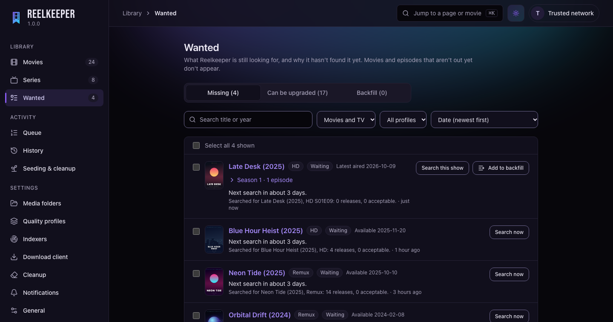
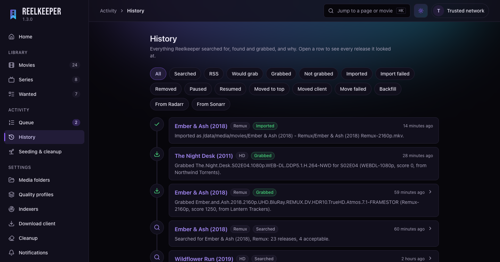
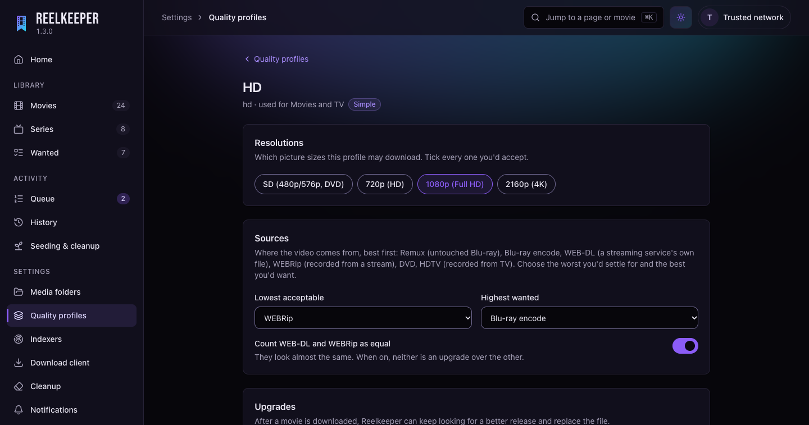
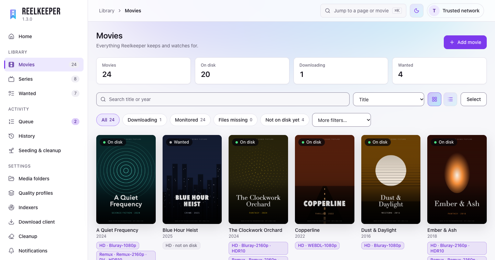

<p align="center">
  
</p>

<h1 align="center">Reelkeeper</h1>

<p align="center">
  <b>One self-hosted app in place of Radarr, Sonarr and Prowlarr.</b><br>
  It finds, downloads, imports and organizes your movies and TV, runs its own
  indexers, and cleans up after itself in your torrent client.
</p>

<p align="center">
  <a href="LICENSE"></a>
  <a href="https://github.com/saltglass/reelkeeper/releases"></a>
  <a href="https://github.com/saltglass/reelkeeper/pkgs/container/reelkeeper"></a>
</p>



## Why Reelkeeper

Running Radarr, Sonarr and Prowlarr means three apps, three databases, three
sets of settings and a lot of glue between them. Reelkeeper is one app that
does the same job, and uses the fact that everything lives together:

- **One library for movies and TV,** including several copies of the same
  title (say 1080p and a 4K remux) without a second instance.
- **Quality profiles in plain choices,** not score arithmetic. The full
  custom-format power is still there under Advanced, and TRaSH Guides JSON
  pastes straight in.
- **Every decision explained.** History says in plain words why each release
  was grabbed or turned down.
- **It cleans up after itself.** Stuck, stalled and dead torrents are dealt
  with, and finished ones are removed once they have seeded enough, never
  before a private tracker's minimum.
- **Seerr keeps working.** To Seerr (and anything else that speaks the
  Radarr or Sonarr API), Reelkeeper looks exactly like Radarr and Sonarr.
- **Small.** A single Go binary with the web UI built in. It runs in a few
  hundred MB of memory with a library of thousands of titles, on SQLite
  (nothing to set up) or PostgreSQL.

## Features

### Library

- A Home page that says at a glance whether anything needs you (a failing
  indexer, a full download disk, downloads that couldn't be imported...),
  each linking to where it's fixed, plus what's downloading, what was just
  grabbed or imported, and what's due this week.
- Movies and TV (standard and daily series) side by side, with poster and
  table views, sorting, filters and search. Select several titles (or all
  that a filter shows) to change monitoring, upgrades or which episodes are
  monitored at once.
- **Versions:** each title can have several copies, each with its own quality
  profile, folder, upgrades and history. A regular copy and a remux are two
  versions of one movie, not two apps.
- Adding an existing library doesn't start upgrading it: each folder decides
  whether movies found there are upgraded, and each movie can be switched on
  or off.
- Scans and identifies an existing library on its own, using IDs in folder
  names when present, otherwise a scored TMDB match. Uncertain matches wait
  for you on a review screen; nothing is guessed silently.
- Reads each file's own headers (MKV and MP4) for resolution, HDR and Dolby
  Vision, codecs, audio tracks, languages and runtime.
- Renaming with Radarr's naming syntax and a live preview. "Rename files"
  shows old and new names before changing anything.
- Episode ordering per series (TMDB episode groups), with mismatches flagged
  rather than guessed.
- **Wanted** lists what is still missing or could be upgraded, and why it
  hasn't been found yet. Select rows to search for them now (10 at a time,
  so a big selection doesn't flood your indexers; the rest wait for the
  hourly search) or to stop looking for them. The **backfill queue** works
  through older seasons of a show, one show at a time.

### Finding releases

- Torznab and Newznab feeds, plus a built-in runtime for Cardigann
  definitions (the format Prowlarr and Jackett use), so hundreds of trackers
  work without extra software. Definitions are downloaded from the community
  repository and kept up to date.
- Import your indexers from Prowlarr.
- Per-indexer rate limits, query and grab limits, backoff when a site
  fails, health and response times.
- Seeding rules per indexer (minimum ratio and seed time), which cleanup
  respects.
- Cloudflare-protected sites through an external FlareSolverr-compatible
  solver.
- Automatic search for new and missing titles, RSS sync, TV season packs,
  and repacks or propers for recent episodes.

### Quality profiles

- Ready-made presets (HD, Remux, 4K, Compact) that most people never need to
  change.
- A simple editor: resolutions, a source ladder (Remux, Blu-ray, WEB-DL,
  WEBRip, HDTV) with "upgrade until", size limits, languages, release groups
  to prefer or block, and HDR, codec and audio features you can require,
  prefer, avoid or block.
- **Upgrades stop where you say.** Once a movie's file reaches your "upgrade
  until" quality, Reelkeeper leaves it alone; prefer and avoid only choose
  between the releases a search finds, they never start another download.
  (A blocked format, or a proper or repack, can still replace it.)
- **Advanced** shows the custom formats and scores behind those choices.
  Import and export TRaSH Guides JSON.
- A "test a release name" box on every profile.

### Downloading

- **qBittorrent, Transmission 4.0+ or Deluge 2.1+.** Reelkeeper only ever
  touches torrents in its own categories (labels in Transmission and
  Deluge).
- **Or its own built-in client (experimental)**: Reelkeeper downloads the
  torrents itself, with no other app to run. Limits on how many torrents
  download and seed at once, optional speed caps, and the same cleanup and
  Queue controls as the others. It never asks your router to open a port.
- **A WireGuard VPN for the built-in client (experimental).** Drop in the
  config file your VPN provider gave you, and everything the client does goes
  through it, with no extra container privileges. Settings shows your real IP
  next to the VPN's, and a kill switch stops every download the moment the
  VPN drops (a banner on the Queue says so), starting again when it is back.
  A small indicator under the app's name shows the VPN's state on every
  page. Without a VPN config, the client is plainly marked as unprotected.
- Activity → Queue with Pause, Resume, Move to top and Remove.
- **Switch clients without losing anything.** Changing the download client
  moves Reelkeeper's torrents to the new one, even half-finished ones: the
  new client checks the files already on disk, so nothing is downloaded
  again, and nothing is ever deleted.
- A queue limit and a "keep this much disk free" setting, so downloads never
  pile up or fill the disk.
- Seerr requests jump the queue.
- Safe imports: copy (or hardlink), verify, then rename into place. Files an
  upgrade replaces are set aside, not deleted.

### Cleanup

- Rules for stalled, slow and stuck torrents, unregistered or deleted
  torrents, failed imports and missing files, each with a strike count so a
  torrent has to fail several checks in a row before anything happens.
- Actions: remove, blocklist the release, search for a replacement.
- Removes finished torrents once they reach your seeding goal, never before
  the tracker's own minimum.
- Reports orphaned torrents and stray files, never deletes them.
- Starts in **dry run**, and every action is logged with its reason.

### Everything else

- A Radarr- and Sonarr-compatible API, one address per quality profile, so
  Seerr can treat your HD and 4K copies as separate servers.
- Sign-in with a local account, single sign-on (OIDC, with an optional
  required group), API keys, and an optional list of trusted networks.
  Works behind a reverse proxy with a URL base.
- Built-in **backups** on a schedule, with restore, which also moves an
  install between SQLite and PostgreSQL.
- Notifications: Emby library refresh, email and webhooks.
- Light and dark themes, usable on a phone, live updates without reloading.

## Screenshots

| | |
| --- | --- |
|  |  |
| **A movie** and every copy of it | **A series** with its seasons and monitoring |
|  |  |
| **Wanted**: what's missing, and why | **History**: every decision in plain words |
|  |  |
| **Quality profiles** as plain choices | **Light theme** |

The titles and posters in these screenshots are made up for the demo.

## Getting started

Reelkeeper runs as one container. With SQLite there is nothing else to set
up:

```yaml
services:
  reelkeeper:
    image: ghcr.io/saltglass/reelkeeper:X.Y.Z   # pick a version from Releases
    container_name: reelkeeper
    restart: unless-stopped
    user: "1000:1000"
    environment:
      TZ: America/New_York
      REELKEEPER_SECRET_KEY: ${REELKEEPER_SECRET_KEY:?REELKEEPER_SECRET_KEY must be set}
    ports:
      - "7676:7676"
    volumes:
      - ./config:/config
      - /data/downloads:/data/downloads   # the same path your torrent client uses
      - /data/media:/data/media
```

Make up the secret key with `openssl rand -hex 32` and keep it safe: it
encrypts the passwords Reelkeeper stores. Then `docker compose up -d` and
open `http://<your-server>:7676`.

You also need a torrent client (qBittorrent, Transmission or Deluge, or the
experimental built-in one) and a
free [TMDB](https://www.themoviedb.org) API key. The
[installation guide](docs/install.md) covers PostgreSQL, folders and paths,
and every setting, including the built-in client's port and its VPN.

## Documentation

1. [Installing](docs/install.md): Docker Compose with SQLite or PostgreSQL,
   all the settings, the secret key, folders and paths.
2. [First-time setup](docs/first-run.md): the screens to visit, in order.
3. [Connecting Seerr](docs/seerr.md)
4. [Signing in and security](docs/sign-in.md): accounts, single sign-on, API
   keys, trusted networks, getting back in.
5. [Backups](docs/backups.md)

## Coming from Radarr, Sonarr and Prowlarr

You don't have to import anything: point Reelkeeper at your existing media
folders and it identifies what's there by itself. If you want your history
and monitored state too, Settings → Media Folders can import from Radarr and
Sonarr, and Settings → Indexers can import from Prowlarr. Then add
Reelkeeper to Seerr as a Radarr and a Sonarr server (see
[Connecting Seerr](docs/seerr.md)) and turn the old apps off when you're
happy.

## What it doesn't do

Reelkeeper deliberately leaves out subtitles (use Bazarr), music and books,
playing media, request management (that's Seerr's job), and solving
Cloudflare challenges itself. Usenet, anime-specific numbering, and library
updates for Jellyfin and Plex (Emby is supported today) are not supported
yet; they're planned for 2.0.

## Development

You need Go (version in `go.mod`), Node.js, [just](https://just.systems) and
golangci-lint. On macOS: `brew install go node just golangci-lint`.

```sh
just dev     # UI at http://localhost:7676 (Vite) + backend with live reload
just test    # all Go and frontend tests
just lint    # must be clean before every commit
just build   # production binary with the UI embedded, in ./bin/reelkeeper
```

`just --list` shows the rest: database tests on PostgreSQL, code generation
from `api/openapi.yaml`, container images, and a local stack of real torrent
clients for integration tests. Design notes and the roadmap are in
[CLAUDE.md](CLAUDE.md).

## Credits

- Movie and TV information comes from [TMDB](https://www.themoviedb.org).
  This product uses the TMDB API but is not endorsed or certified by TMDB.
- Bundled custom formats come from [TRaSH Guides](https://trash-guides.info)
  (MIT).
- Indexer definitions are downloaded at runtime from the
  [Prowlarr/Indexers](https://github.com/Prowlarr/Indexers) community
  repository; none are shipped with Reelkeeper.
- Some parser test cases are adapted from Radarr's and Sonarr's tests
  (GPL-3.0).

## License

[GPL-3.0](LICENSE)
